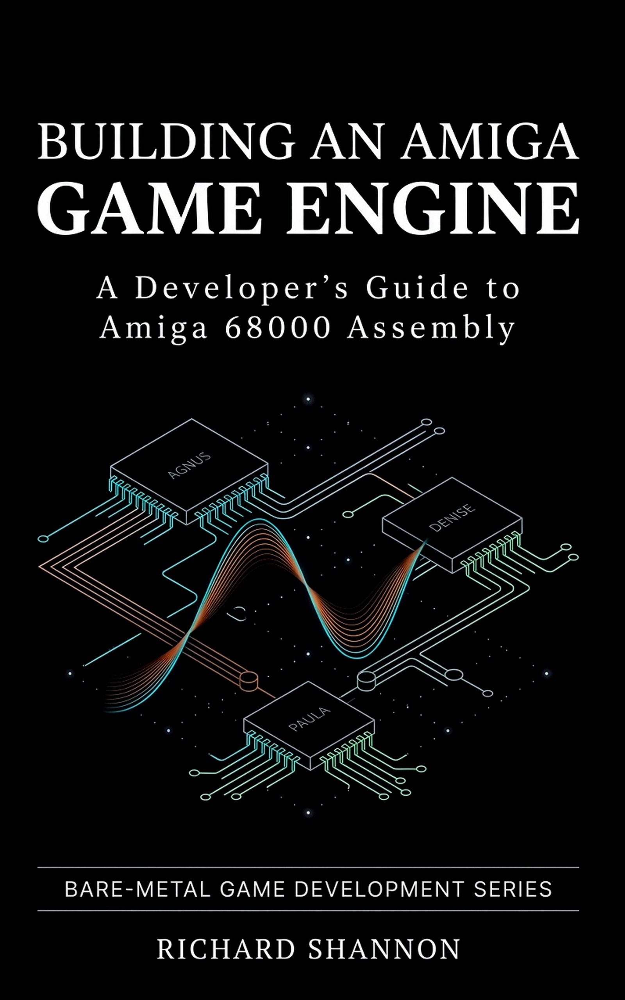

# AMIGA Game Engine

<p align="center">
  <a href="https://www.amazon.com/s?k=Building+an+Amiga+Game+Engine" target="_blank">
    
  </a>
  <br><br>
  <strong>Official companion repository for the engineering guide:</strong><br>
  <a href="https://www.amazon.com/s?k=Building+an+Amiga+Game+Engine" target="_blank">
    <strong>Building an AMIGA Game Engine: A Developer's Guide to Amiga 68000 Assembly</strong>
  </a>
  <br>
  <em>Published via Amazon KDP — available worldwide as a full-colour paperback, a black-and-white hardcover and a Kindle ebook</em>
  <br><br>
  <a href="https://www.amazon.com/s?k=Building+an+Amiga+Game+Engine">
    
  </a>
  <a href="https://github.com/ELMGames/AmigaGameEngine/pulls">
    
  </a>
  <a href="https://github.com/ELMGames/AmigaGameEngine/issues">
    
  </a>
</p>

---

> [!NOTE]
> ### 📖 The Official Companion Book
> This repository contains the complete codebase accompanying the engineering manual **_Building an AMIGA Game Engine_**.
> 
> * **Hardware Mastery:** Step-by-step architectural breakdown of Agnus (DMA & Blitter), Denise (display windows & sprites), and Paula (4-channel stereo audio & CIA timers).
> * **Production Patterns:** Bare-metal OS takeover, pinned `a5` registers, computed-goto state dispatch, beam-racing frame models, and Elias Gamma ZX0 asset decompression.
> * **Available on Amazon KDP:** Order your copy on Amazon ([Search on Amazon](https://www.amazon.com/s?k=Building+an+Amiga+Game+Engine)) to follow the complete guide with exhaustive timing diagrams, register maps, and architectural deep-dives.

> [!TIP]
> ### 🛠️ Community Contributions, Suggestions, & Bug Reports Welcome
> Building a bare-metal game engine from scratch across vintage custom silicon is a large, intricate engineering undertaking. While every routine across this engine has been tested in cycle-exact WinUAE, **there will inevitably be bugs, edge cases, and opportunities for performance refinement**.
> 
> I believe in the power of an open retro computing community. Developers, demoscene coders, and assembly enthusiasts are warmly encouraged to contribute:
> * **Submit Pull Requests:** Found a bug, an unhandled hardware quirk, or a cleaner structural pattern? Fork the repository and open a pull request!
> * **Propose Optimizations:** Squeezed extra cycles out of a Blitter minterm, Copper list, or 68000 inner loop? We welcome cycle-saving optimizations.
> * **Share Suggestions & Additions:** From new toolchain utilities to expanded game mechanics, feedback and additions are always welcome.

---

A high-performance Motorola 68000 assembly game engine for Commodore Amiga OCS/ECS systems. Its target is the machine most players owned: an **A500** (OCS, 68000 at 7.09 MHz PAL) with 512 KB of Chip RAM plus the 512 KB trapdoor expansion (Slow RAM, or 512 KB of Fast RAM), 1 MB in all. It also runs on the A600 and A2000 and on NTSC machines.

> [!IMPORTANT]
> The code that matches the first edition of the book is tagged **`v1.0-book`**. To follow the book exactly, clone that tag:
> ```
> git clone --branch v1.0-book https://github.com/ELMGames/AmigaGameEngine.git
> ```

Out of the box, it features a complete boot-to-gameplay pipeline: custom OS takeover with clean CLI exit, intro flash banner splash, a retro ZX Spectrum-style tape loading sequence, an interactive title screen with dynamic Copper aurora effects, a 3-track ProTracker soundtrack composed by JAM (`h3xaflight`), playable adventurer **Mia** (featuring custom animations and ponytail physics), a terminal-style **GAME OVER** sequence, a starfield victory **Game Complete** screen, and a modern **Tiled `.tmx` level editor pipeline** supporting multi-layer 16×16 tilemaps, tall scrolling levels (up to 50 rows / 800 scanlines), cookie-cut Player & Enemy Blitter Objects (BOBs), asynchronous crate physics, animal friend rescue objectives, hardware sprite HUDs, rising water flood mechanics, VHS tape rewind/undo, and frame-by-frame debug stepping.

---

## Key Features

* **Modern Tiled (`.tmx`) Workflow:** Author multi-layer levels in the standard Tiled map editor. The Python pipeline (`games/duck_rescue/tools/export_level.py`) automatically compiles levels into planar tileset graphics, blitter masks, composite maps, 1D collision logic maps, and 68000 assembly entity tables under `games/duck_rescue/include/levels/`.
* **Playable Protagonist (Mia):** Play as **Mia**, a female adventurer featuring custom animated ponytail physics and red adventurer tunic across all actions (walk, idle, ladder climbing, cane attack, flailing fall, and collapse death). Her master right-facing graphics stream directly from Chip RAM (`data_chip`). Dynamic boot-time horizontal mirroring (`PlayerInitFlippedSprites`) mirrors her right-facing master graphics into a single set of left-facing Chip RAM BSS buffers, cutting asset disk footprint in half while maintaining full 512 KB Chip RAM compatibility.
* **Beam-Raced Blitter Pipeline:** A single displayed buffer, drawn top of the screen first. Objects in the top three tile rows (and the player, when it is up there) are erased and cookie-cut (`BLTCON0 = $0FCA`) as priority work at the start of the frame, before the beam reaches them; everything lower follows in screen order behind the beam. Redraws made during the game logic wait for the beam to clear their lines. The order and its rules are in the [Blit Order Guide](docs/BLIT_ORDER_GUIDE.pdf).
* **16-Colour Player & Enemy BOBs:** Dedicated conversion tools (`games/duck_rescue/tools/convert_player_bob.py`, `games/duck_rescue/tools/convert_enemies.py`) generate 4-bitplane, 16-colour Blitter Objects (BOBs) with separate blitter masks and white flash/invulnerability silhouettes.
* **Terminal-Style "GAME OVER" Sequence:** Losing all 3 lives transitions to a dedicated retro computer-terminal screen (`purge.png`), featuring a deep crimson backdrop (`COLOR00 = $0711`), terminal header/telemetry, white horizontal dashed lines, and centered flashing Michroma typography (`GAME` / `OVER`) with a 4-second timeout returning cleanly to the Title Menu (or skippable via fire/key).
* **Pushable Blocks & Asynchronous Physics (`BLOCK_PUSH`):** Smooth quadratic-eased push animations. Crates pushed off platform edges fall asynchronously in parallel, allowing the player to continue walking immediately without freezing or waiting for the crate to land. Seamless overlap compositing guarantees zero cutout flicker between player and crates.
* **Hardware Sprite HUD Subsystem:** Real-time HUD elements rendered via hardware sprites, so they cost no Blitter time and almost no CPU time (a frame update swaps one pointer in the Copper list):
  * **SPR0:** Player Lives counter indicator.
  * **SPR2:** Oxygen Kit inventory pickup.
  * **SPR3:** Animal Friends Remaining counter, featuring a custom animal icon and live numerical digit tracking.
  * **SPR4:** Oxygen (lung) gauge, shown only while Mia is submerged.
  * **SPR6:** In-world rising air bubble.
* **Animal Friends Rescue Objective:** Dynamic rescued friend tracking (Bunnies, Puppies, Kittens, Ducklings, Chicks) with sub-pixel animations, pickup collision, and audio feedback.
* **Dynamic Rising Water Flood:** Scaled PAL/NTSC timer-driven rising water layer (`engine/effects/water_effects.asm`) with an animated 4-line surface wave crest, automatic deep-water fill (`50%` cyan dither stipple) across all rows below the level's starting waterline down to the bottom of the map, continuous `cpGameSky` Copper sky gradient blending through the underwater stipple (with VBlank/bottom-margin `COLOR00` reset), and real-time actor submersion dimming.
* **Oxygen Depletion & Collectibles:** Submerged breath depletion meter with rising air bubbles, drowning hazards, and collectible oxygen refill canisters.
* **Interactive Slow Mode & Step Debugging:** Press **S** at any time to pause the gameloop and enter SLOW MODE with a real-time on-screen telemetry overlay. Tap **A** to advance the engine exactly one frame, or hold **A** to advance at full speed.
* **VHS Rewind & Undo Subsystem:** Press **F9** to step backward through a 16-entry circular undo snapshot buffer (`engine/gameplay/undo.asm`, `engine/effects/vhs_rewind.asm`), restoring player, crate, enemy, friend, oxygen, and rising water state with an authentic 40-frame (0.8 s PAL) VHS tape rewind effect (top/bottom tracking snow bands, horizontal LFSR line-smear tear, and `REW <<` OSD overlay) while preserving all composited actors on screen.
* **Randomized Colored Block Screen Wipes:** Transitions between loading, menus, and levels (`engine/graphics/screenutils.asm`, `engine/gameplay/levelutils.asm`) render a 20×9 grid of `16×24` beveled 3D blocks using a randomized palette theme per wipe (seeded via Agnus `VHPOSR` beam position + LFSR), followed by a short hold before advancing.
* **Efficient Memory Model:** Strict separation between Chip RAM (DMA-accessible copper lists, screen bitplanes, audio, and BOB buffers) and Fast RAM (code, state tables, level logic, and BSS variables). Runs comfortably in **512 KB Chip RAM** with about **175 KB free headroom**, in Chip sections of 80 KB or less so it still loads when Workbench has fragmented Chip RAM.
* **Audio & Soundtrack:** Built-in 4-channel ProTracker playback engine powered by Frank Wille's PTPlayer with 11 synthesised sound effects (plus the intro fanfare) and a complete 3-track soundtrack composed by **JAM (`h3xaflight`)**:
  * Title Theme: *Heatwave Cruise*
  * Level Theme: *XLR8*
  * Completion Theme: *10k Reggae Dub*
* **Clean OS Takeover & Exit:** Gracefully suspends AmigaOS (saving viewports, DMACON, interrupt vectors and the CIA timers it borrows) and restores the system cleanly on exit. Starts from the Shell or from its own Workbench icon, and returns to whichever it came from.
* **Fault Screen:** Any CPU exception (bus or address error, illegal instruction, zero divide, privilege violation, line-A/F, trap) or a failed bounds check stops on a readable report: the exception name, `PC`, `SR`, the faulting address (decoded for every CPU from the 68000 to the 68060), the opcode and every register, with a flashing FAULT. It fits PAL and NTSC screens.

---

## Quick Start

### Prerequisites
* **Assembler & Linker:** `vasmm68k_mot` and `vlink` (available on `PATH`, configured in `AMIGA_TOOLCHAIN`, or bundled with the [amiga-assembly](https://marketplace.visualstudio.com/items?itemName=prb28.amiga-assembly) VS Code extension).
* **Python 3** with Pillow (`pip install Pillow`): required for the asset and level pipeline.
* **Emulator:** WinUAE on Windows, or FS-UAE on macOS, Linux and Windows, with a Kickstart 1.3 ROM, or the free AROS ROM built into WinUAE (see the [launch profiles guide](docs/VSCODE_LAUNCH_PROFILES_GUIDE.pdf)). The `FS-UAE A500` profile uses the FS-UAE build that comes with the amiga-assembly extension, so there is nothing else to install. On macOS, use `python3`, and on Apple Silicon install Rosetta 2 (`softwareupdate --install-rosetta`), because the extension's tools are Intel builds.
* **Optional:** `pip install amitools` for the floppy image (`xdftool`). Without it, the build prints a note and carries on.
* **Kickstart ROMs:** copy your own into the `roms/` folder (see [`roms/README.md`](roms/README.md)). Git ignores them, as they are copyrighted.

### Building and Running in VS Code (recommended)

The root `main.asm` chooses which game is built:

```asm
    include "games/duck_rescue/main.asm"    ; or games/starter/main.asm
```

Press **F5** in VS Code: the `amigaassembly: build` task assembles and links it to `uae/dh0/main`, then the selected launch profile boots it in WinUAE or FS-UAE. The A500, Workbench and FS-UAE profiles run `build + ADF` instead, which also writes a bootable floppy image, `adfs/game.adf` (see below). `Ctrl+Shift+B` builds without running. F5 assembles code only: after changing art, palettes or levels, regenerate the assets with `python build.py --assets`.

### Building from the Command Line

```powershell
python build.py --game duck_rescue  # Export Tiled levels + convert assets + assemble + link to uae/dh0/main
python build.py --assets            # Regenerate all converted assets (art, levels, SFX, data tables)
python build.py --check             # Run the test suite first; build only if it passes
python build.py --game X --explain  # On a failed build, list every missing contract symbol
```

The compiled Amiga executable lands by default at `uae/dh0/main` (`--out` changes it). The launch profiles mount `uae/dh0` as `dh0:`, and the same file runs on a real Amiga.

### A Bootable Floppy Image

```powershell
python make_adf.py                  # release build of the current game -> adfs/game.adf
```

The disk holds the game, its Workbench icon and an `S/Startup-Sequence`. It boots on its own from `DF0:` or a Gotek, and the Workbench launch profile puts it in `DF1:` next to a Workbench 1.3 disk, so the game appears as a disk icon. Put your own Workbench disk image in `adfs/` (see [`adfs/README.md`](adfs/README.md)): like the ROMs, it is copyrighted, so Git ignores it.

### Running the Tests

```powershell
python -m unittest discover tests   # converter and executable golden files, engine contract, book references
python tests/update_golden.py       # accept an intentional converter/art change
python tests/update_golden.py --executables  # accept an intentional code change, once checked in the emulator
```

Starting a new game? Copy `games/starter/` and follow the [Making a Game guide](docs/MAKING_A_GAME_GUIDE.pdf). Naming and layout rules are in the [Coding Conventions guide](docs/CODING_CONVENTIONS_GUIDE.pdf). All seven companion guides (draw order, ring buffer, asset pipeline, launch profiles and more) are PDFs in [`docs/`](docs/).

### Controls

| Input | Context | Function |
| :--- | :--- | :--- |
| **Cursor Keys / Joystick** | In-Game | Player movement and ladder climbing |
| **Space / Fire Button** | In-Game | Cane hook action / swing trigger |
| **F9** | In-Game | **VHS Rewind / Undo** last move (restores snapshot with `REW <<` tape effect) |
| **F8** | In-Game | Restart the current level |
| **P** | In-Game | Toggle **PAUSE** / **UNPAUSE** (displays a `PAUSED` banner) |
| **S** | In-Game | Toggle **SLOW MODE** on/off (activates debug HUD with `MODE:SLOW`) |
| **A** (Tap) | In-Game (Slow Mode) | **Step gameloop** forward by exactly one frame |
| **A** (Hold) | In-Game (Slow Mode) | Advance gameloop at full speed while held down |
| **D** | In-Game | Toggle the **Debug Telemetry HUD** while in Slow Mode (`CAM`, `PLY`, `ACT`, `DIR`, `ENM`, `WTR`, `MODE`) |
| **ESC** | In-Game | Fade out and return to the Title Screen |
| **F5** | In-Game | Toggle developer debug mode (enables F1/F2 level skip and F4 complete skip) |
| **F1 / F2** | In-Game (Debug Mode) | Skip to previous / next level |
| **F4** | In-Game (Debug Mode) | Jump directly to Game Complete ending screen |
| **F3** | In-Game (Debug Mode) | Toggle raster CPU-timing bar (yellow = priority blits for the top rows, green = the rest of the frame, red = overrun) |
| **Cursor Keys / Joystick** | Title Menu | Navigate menu options (Play Level, Instructions, Credits, Quit) |
| **Return / Fire / Space** | Title Menu | Confirm selection |
| **A–P / Backspace** | Title Menu | Enter a level password |
| **F5** | Title Menu | Toggle developer debug mode |
| **Fire / Return / ESC** | Game Over | Skip 4-second delay and return immediately to Title Screen |
| **ESC** | Title Screen | **Quit to OS** (clean return to CLI prompt) |
| **F6** | Loading Screen | Skip tape-loading animation |

---

## Architecture & Hardware Allocation

### Hardware Sprite Channel Mapping

| Sprite Channel | Copper Offset | Purpose | Characteristics |
| :---: | :---: | :--- | :--- |
| **SPR0** | `cpSprites + 0` | Player Lives Counter | Visual heart/head HUD counter for player lives |
| **SPR1** | `cpSprites + 8` | Free | Points at `NullSprite` |
| **SPR2** | `cpSprites + 16` | Oxygen Kit Indicator | Collectible scuba inventory item display |
| **SPR3** | `cpSprites + 24` | Friends Remaining Counter | Animal icon + live single-digit numerical countdown |
| **SPR4** | `cpSprites + 32` | Oxygen Gauge | Lung gauge, 28 lines, shown only when submerged or depleted |
| **SPR5** | `cpSprites + 40` | Free | Points at `NullSprite` |
| **SPR6** | `cpSprites + 48` | Air Bubble | Dynamic in-world air bubble (16×8) |
| **SPR7** | `cpSprites + 56` | Free | Points at `NullSprite` |

### Memory Footprint

Section sizes as `vasm` reports them in the build terminal (F5 or `python build.py`); `games/duck_rescue/tools/chip_ram_report.py` gives a per-file breakdown:

| Section | Target RAM | Allocation | Description |
| :--- | :--- | :---: | :--- |
| **`main` (Code)** | Fast/Chip RAM | ~58.5 KB | Complete 68000 instruction stream assembled as a single translation unit |
| **`data_fast`** | Fast RAM | ~214.8 KB | Read-only tables (sine, easing), ZX0 loading assets, intro fanfare, end-screen audio (staged into Chip RAM), TMX level tilemaps |
| **`mem_fast` (BSS)** | Fast RAM | ~55.2 KB | Game state, actor records (`a5` base), keyboard buffer, undo snapshot ring buffer, stack |
| **`data_chip`, `chip_audio`, `chip_sfx`, `chip_gfx`** | Chip RAM | ~149.9 KB | Copper lists, fonts, level music (`xlr8.mod`), SFX PCM samples, BOBs (Mia), tilesets, enemies |
| **`mem_chip`, `chip_display`, `chip_backdrop` (BSS)** | Chip RAM | ~187.0 KB | `DisplayScreen` and `NonDisplayScreen` (a section each), dynamic flipped player frames (`PlayerLeft*`), null sprites |

* **Total Chip RAM Usage:** **345,044 bytes (~337.0 KB)**, in seven sections of 80 KB or less so the game still loads when Chip RAM is fragmented.
* **Chip RAM Free Headroom:** **179,244 bytes (~175.0 KB)** within the standard **512 KB** limit.

---

### State Machine (`engine/gameplay/gamestatus.asm`)

Game execution is dispatched every video frame via `GameStatus(a5)`:

| State Index | Identifier | Handler | Implementation File | Description |
| :---: | :--- | :--- | :--- | :--- |
| `0` | `GAME_INIT` | `LoadingSetup` | [`engine/screens/loading.asm`](engine/screens/loading.asm) | One-shot tape loading initialization |
| `1` | `GAME_LOADING` | `LoadingRun` | [`engine/screens/loading.asm`](engine/screens/loading.asm) | Per-frame tape loader animation, then a block wipe to the title (F6 skips) |
| `2` | `GAME_RUN` | `GameRun` | [`engine/gameplay/gamestatus.asm`](engine/gameplay/gamestatus.asm) | Active gameplay loop (player, actors, blits, VHS rewind, slow mode) |
| `3` | `LEVEL_INIT` | `LevelTransitionRun` | [`engine/gameplay/levelutils.asm`](engine/gameplay/levelutils.asm) | One-shot per-level initialization and random wipe color selection |
| `4` | `LEVEL_WIPE` | `LevelTransitionRun` | [`engine/gameplay/levelutils.asm`](engine/gameplay/levelutils.asm) | Blits the end-of-level beveled coloured block wipe, then holds |
| `5` | `LEVEL_HOLD` | `LevelTransitionRun` | [`engine/gameplay/levelutils.asm`](engine/gameplay/levelutils.asm) | Stages next level while screen is covered |
| `6` | `LEVEL_REVEAL` | `LevelTransitionRun` | [`engine/gameplay/levelutils.asm`](engine/gameplay/levelutils.asm) | Reverse-wipe level reveal transition |
| `7–8` | `LEVEL_COMPLETE_*` | `LevelCompleteSetup/Run` | [`engine/screens/levelcomplete.asm`](engine/screens/levelcomplete.asm) | Level victory summary, portrait, and password screen |
| `9` | `TITLE_SETUP` | `TitleSetup` | [`engine/screens/titlescreen.asm`](engine/screens/titlescreen.asm) | Title screen init (copper aurora, title logo, menu) |
| `10` | `TITLE_RUN` | `TitleRun` | [`engine/screens/titlescreen.asm`](engine/screens/titlescreen.asm) | Interactive title menu & background animation |
| `11–16`, `25–26` | `INSTR_*` | `InstrPage*Setup/Run` | [`engine/screens/instructions.asm`](engine/screens/instructions.asm) | Four-page how-to-play booklet (page 4 uses states 25–26) |
| `17–18` | `CREDITS_*` | `CreditsSetup/Run` | [`engine/screens/credits.asm`](engine/screens/credits.asm) | Audio, graphics, tools, and engine credits screen |
| `19–20` | `GAME_COMPLETE_*` | `GameCompleteSetup/Run` | [`engine/screens/gamecomplete.asm`](engine/screens/gamecomplete.asm) | Game complete victory sequence & credits starfield |
| `21–22` | `GAME_OVER_*` | `GameOverSetup/Run` | [`engine/screens/gameover.asm`](engine/screens/gameover.asm) | Terminal-style Game Over sequence |
| `23–24` | `FLASH_*` | `FlashSetup/Run` | [`engine/screens/flashscreen.asm`](engine/screens/flashscreen.asm) | Initial boot splash banner & trumpet fanfare |

---

## Asset & Level Pipeline

All game assets are processed deterministically via scripts in [`games/duck_rescue/tools/`](games/duck_rescue/tools/), and every output is pinned by the golden-file tests in [`tests/`](tests/):

1. **Level Authoring (`games/duck_rescue/tools/export_level.py`)**:
   - Converts Tiled `.tmx` maps (`games/duck_rescue/assets/levels/Level_01/` through `Level_06/`) into planar Amiga data.
   - Outputs:
     - 16-colour planar raw tileset (`tileset-compact_176x80.raw`) and blitter mask (`.msk`).
     - Multi-layer binary maps: `*-background.map`, `*-platform.map`, `*-ladder.map`, `*-foreground.map`, and composite `*.map`.
     - 1D logic collision map (`*-gamemap.bin`).
     - 68000 assembly definitions (`games/duck_rescue/include/levels/level_XX_entities.asm`) specifying player spawns, ladders, patrol paths, push blocks, oxygen pickups, and animal friends.

2. **Player BOB Pipeline (`games/duck_rescue/tools/convert_player_bob.py`)**:
   - Generates 16-colour, 4-bitplane raw graphic sheets, blitter masks (`.msk`), and pure-white silhouettes (`_white.raw`) for **Mia** (`player_bobs_female_128x144.*`) (9,216 bytes).
   - Mia's sprite sheet features an animated ponytail across all 6 action rows (idle, walk, attack, death, ladder, falling) and custom red adventurer tunic.
   - At boot, `PlayerInitFlippedSprites` dynamically flips right-facing master graphics into a single set of left-facing Chip RAM BSS buffers (`PlayerLeftRaw`, `PlayerLeftMsk`, `PlayerLeftWhiteRaw`), cutting disk footprint in half and conserving precious Chip RAM.
   - Pass `--preview` to export a visual contact sheet (`player_female_preview.png`) for inspection.

3. **Animal Friend & Enemy Pipelines (`convert_animals.py`, `convert_enemies.py`)**:
   - Exports planar graphics, blitter masks, and optional animated GIF/PNG previews (via `--preview`) for enemies, dizzy stars, and animal companions.

4. **Audio & Sound Effects Pipeline (`generate_sfx.py`)**:
   - Synthesizes 8-bit signed PCM audio samples for game SFX (cane swing, crate push/impact, enemy stun, duck rescue, oxygen, player death, bubble pop, fanfare).

5. **Data Tables (`convert_data_tables.py`)**:
   - Builds `sin.bin` and `quadratic.bin` from the readable sources `assets/data/sin.txt` and `quadratic.txt` on every build.

6. **Loading Screen & ZX0 (`convert_loading_screen.py`, `engine/system/zx0_faster.asm`)**:
   - Converts the 32-colour loading picture to 5 interleaved bitplanes (40,000 bytes) and compresses it with Einar Saukas' ZX0 (v2) to 19,634 bytes. Run it by hand when the picture changes; `build.py` does not run it. It needs `amigeconv` and `zx0`, which are not included: see `get_amigeconv.txt` and `get_zx0.txt` in `games/duck_rescue/tools/`.
   - At boot the 68000 decompresses it from Fast RAM straight into Chip RAM.

---

## Repository Structure

```
.
├── main.asm                        # Root build file: includes the game to build (F5 in VS Code)
├── build.py                        # Command-line build driver (assets, --check, --explain)
├── make_adf.py                     # Bootable floppy image of the current game -> adfs/game.adf
├── .vscode/                        # Build tasks and launch profiles: WinUAE (Kickstart 1.3, AROS, NTSC,
│                                   #   A1200, A4000, Workbench + DF1:) and FS-UAE (macOS, Linux, Windows)
├── adfs/                           # game.adf (made by make_adf.py) and your own Workbench disk (ignored by Git)
├── roms/                           # Your own Kickstart ROMs (ignored by Git; see roms/README.md)
├── uae/dh0/                        # The emulated hard drive: main, starter, their icons, S/startup-sequence
├── docs/                           # Companion guides (PDF) and the book cover
├── engine/                         # Reusable bare-metal 68000 game engine
│   ├── audio/                      # Audio driver & PTPlayer integration (audio.asm, ptplayer.asm, zxsfx.asm)
│   ├── core/                       # Engine macros (macros.asm)
│   ├── effects/                    # Visual & environmental effects (vhs_rewind.asm, water_effects.asm)
│   ├── gameplay/                   # State machine, actors and physics, entities, undo snapshots, level transitions
│   ├── graphics/                   # Copper lists and sky, BOB compositor, TMX renderer, screen wipes, fades, debug HUD
│   ├── include/                    # Constants, structures and variables (engine_const.i, engine_variables.i, *_struct.i), hardware headers
│   ├── screens/                    # Screen state handlers (loading, titlescreen, instructions,
│   │                               #   credits, levelcomplete, gamecomplete, gameover, flashscreen, pause)
│   └── system/                     # OS takeover, fault trap, keyboard, controls, tools, zx0_faster
├── games/
│   ├── starter/                    # Minimal template for a new game: gradient, HELLO / WORLD, ESC quits (see docs/MAKING_A_GAME_GUIDE.pdf)
│   └── duck_rescue/                # Example game: Duck Rescue (starring Mia)
│       ├── main.asm                # Game entry point, memory sections, main loop, VBlank ISR
│       ├── assets/                 # Game-specific graphics, Tiled .tmx levels, ProTracker music, SFX
│       ├── include/                # Game code: hooks, core/, gameplay/ (player_*.asm), graphics/ (HUD sprites, BOBs), levels/
│       └── tools/                  # Level exporter, asset converters (BOBs, animals, enemies, SFX, data tables), Chip RAM report
└── tests/                          # Golden-file, engine-contract and book-reference tests
```

---

## Verification & Diagnostics

* **Tear-Free Draw Order:** Every blit runs in screen order ahead of the beam (top rows first as priority work), and out-of-pass redraws wait for the beam; see the [Blit Order Guide](docs/BLIT_ORDER_GUIDE.pdf).
* **Fault Screen:** If a CPU exception or an invalid game state occurs, the engine stops on a report of the exception, `PC`, `SR`, faulting address, opcode and every register, with a flashing FAULT, until the Amiga is reset. Chapter 20 of the book has a Try-it that triggers each kind of fault.
* **Frame Budget Raster Meter:** Press **F5** then **F3** in-game to display the real-time raster bar. Yellow marks the priority blits for the top three tile rows (it starts in the top border; a few lines into the playfield is normal), green the rest of the frame's work, and red a frame overrun.
* **On-Screen Diagnostic Overlay:** Press **S** (Slow Mode) to view live camera coordinates, player X/Y tile and sub-tile positions, action state, direction, active enemy count, waterline row, and current loop speed mode (`RUN` or `SLOW`). In Slow Mode, **D** hides or shows the overlay.
* **Frame Step Debugger:** Press **S** to halt execution and inspect animations, collision logic, crate movement, and enemy patrol behaviors frame-by-frame with the **A** key.

## Third-Party Code

ptplayer and the ZX0 decompressor keep their own terms: see `THIRD_PARTY_NOTICES.md`.
